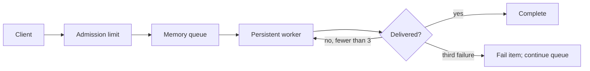

# Receipt worker: approve bounded retries

**Decision:** approve one persistent worker with three attempts per idempotent receipt. An exhausted item fails individually; later items continue.

**Scope:** V1 uses an in-memory queue. Process exit loses queued work; acceptance is not a durability promise.

## Mechanism

| Choice | Benefit | Cost |
| --- | --- | --- |
| Memory queue | Small deployment and low latency | Restart loses work |
| Durable queue | Restart recovery | More infrastructure and operational work |

## Review questions

- Does the client contract clearly state process-local acceptance?
- Is the idempotency key scoped correctly for receipt delivery?
- What admission limit protects memory during an outage?

## Evidence

A production rollout needs measured queue depth and retry exhaustion rates. The values are not yet measured; the recommendation is conditional on a limited pilot.
